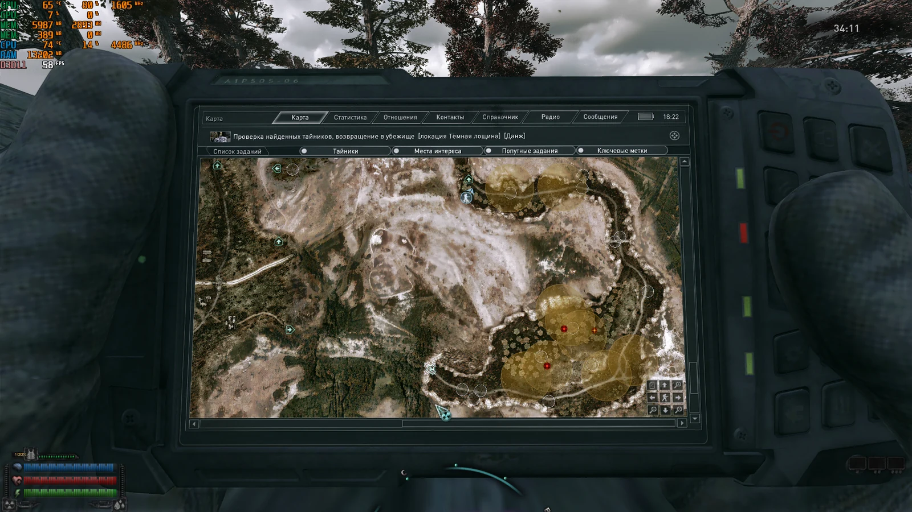
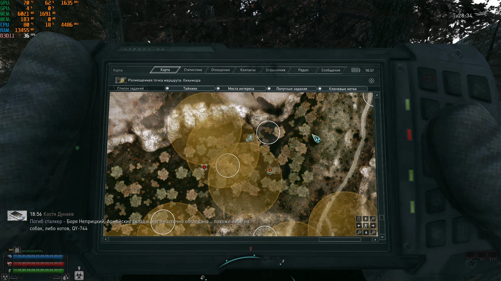
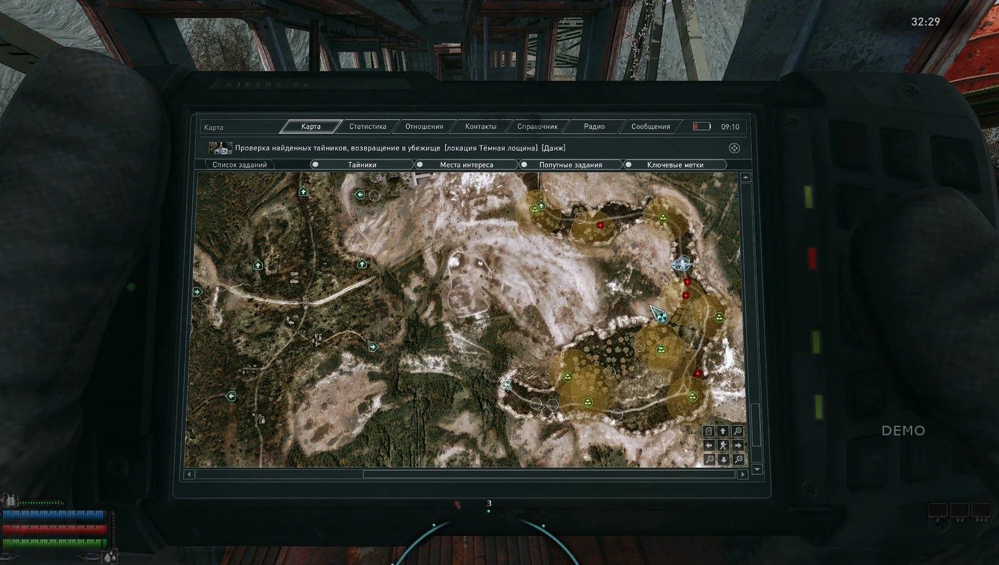
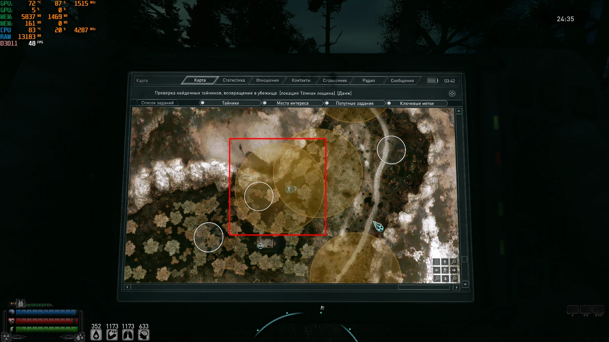
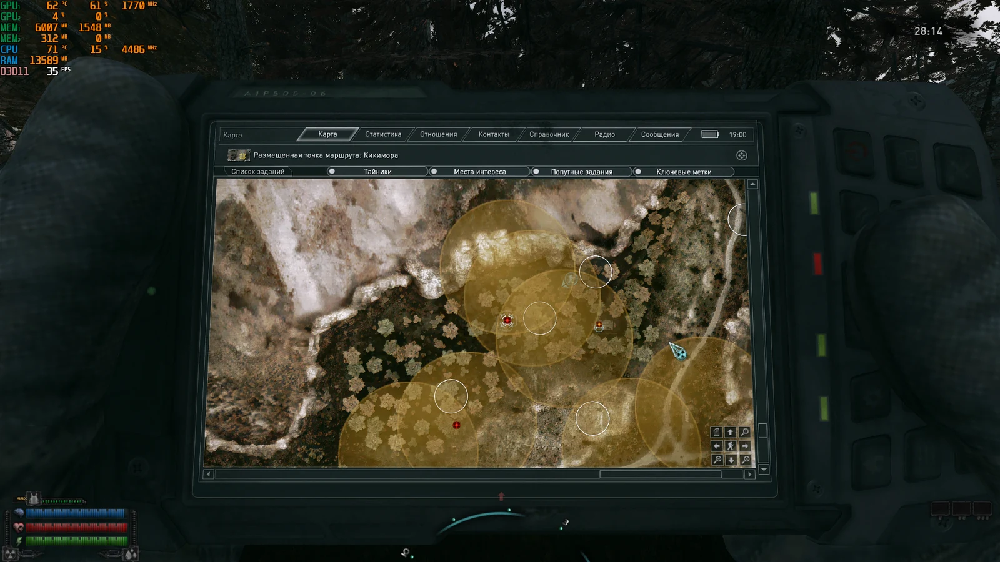
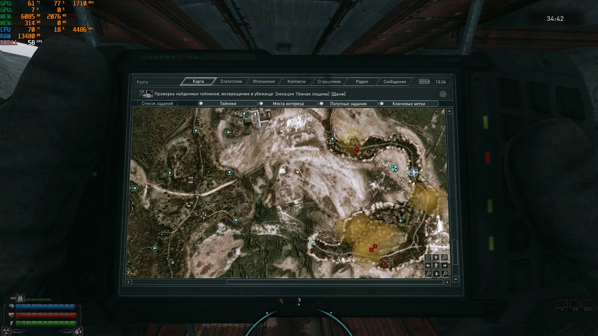

# Anomaly Expedition Rework by White_Angel

Текущая публичная версия: **0.3.0-rc7**. Это открытый MO2-мод для конкретной сборки GRA 2.5 с активным `GRA Bolt`. Он добавляет в аномальные вылазки приблизительные районы поиска рейдовых артефактов, ложные районы с опасностью, добычей или пустышкой и расширенные награды. Файлы исходных модов не изменяются.

Новая игра не нужна. После установки достаточно полностью перезапустить игру; AER начнёт работать при следующем входе на локацию новой аномальной вылазки.

## Термины

- **RVM** — внутренняя система рейдов и вылазок этой сборки. Знать её устройство для игры не требуется.
- **Рейдовый артефакт** — артефакт, который RVM создаёт специально для аномальной вылазки. Обычные артефакты мира и артефакты Arrival мод не помечает.
- **Настоящая область** — жёлтый круг, внутри которого находится связанный рейдовый артефакт. **Ложная область** выглядит так же, но может содержать засаду мутантов, контейнер с добычей или ничего.
- **MO2** — Mod Organizer 2, через который устанавливается и включается мод.
- **FOMOD** — окно установщика, которое MO2 показывает после открытия архива.
- **MCM** — меню настроек модов внутри игры.
- **PAW** — Personal Adjustable Waypoint, мод маршрутных точек на карте.

## Совместимость и зависимости

RC7 разработан и проверен только для фактического стека GRA 2.5: `GRA Bolt`, Rojok Artifact System, Arrival, PAW и Anomaly MCM 1.7.2. На другой сборке или отдельно от GRA 2.5 совместимость не заявлена.

Anomaly MCM даёт поддерживаемый интерфейс настроек. Если его API временно недоступен, AER безопасно берёт значения из LTX, но обычный пользовательский сценарий рассчитан на MCM. PAW предоставляет текстуры необязательных зелёной и красной точных иконок; сами приблизительные круги принадлежат AER. Arrival совместим: его обычные артефакты AER не перехватывает.

## Установка

1. Скачать `Anomaly-Expedition-Rework-0.3.0-rc7.zip` со страницы [GitHub Release](https://github.com/WhiteAnge1/anomaly-expedition-rework/releases/tag/v0.3.0-rc7).
2. В MO2 выбрать установку из архива и открыть ZIP.
3. В окне FOMOD нажать обычную кнопку **«Установить»**. Ручная перестройка дерева не нужна: архив уже содержит правильные `gamedata` и `fomod`.
4. Оставить предложенное имя `[Геймплей] Anomaly Expedition Rework by White_Angel v0.3.0-rc7`.
5. В левой панели MO2 разместить AER **ниже** `GRA Bolt`, Arrival и PAW. У него должно быть **большее число в столбце Priority**: нижний мод с большим числом выигрывает возможные файловые конфликты. В RC7 игровые пути AER отдельные, а map spot добавляется через DXML, но это проверенный порядок сборки.
6. Убедиться, что включена только одна версия AER. Старые alpha/RC-копии нужно отключить, а не объединять с RC7.
7. Если игра была открыта, полностью выйти на рабочий стол и запустить её заново.

Уже полученный маршрутный лист можно использовать: он задаёт тип и локацию, а содержимое создаётся при переходе на карту вылазки. Если обходными средствами загружено сохранение уже внутри старой вылазки, созданный до установки контент задним числом не перестраивается — начните следующую вылазку.

## Обновление, откат и удаление

- Новую версию устанавливайте отдельной записью MO2, затем отключайте старую. Не объединяйте каталоги и не копируйте старый LTX поверх новой версии.
- После обновления или отката полностью перезапускайте игру. Новое прохождение не требуется; новые настройки применяются к следующей новой вылазке.
- Открытые зоны RC6 мигрируют в RC7 без повторного создания артефакта, тайника или отряда. Для чистой проверки обновления удобнее начать следующую вылазку.
- Для отката включите прежнюю отдельную запись. Сохранение с незавершённой зоной безопаснее загружать с той версией AER, которая её создала.
- Отключение AER возвращает исходное поведение вылазок. Механика подключается отдельными скриптами; LTX-переопределения меняют только описания маршрутных листов.

## Как играть и что настраивается

Получите маршрутный лист аномальной вылазки и войдите на указанную локацию. На карте появятся жёлтые приблизительные круги. Настоящие и ложные области специально выглядят одинаково: исследуйте круг, найдите артефакт, контейнер или угрозу и завершите связанную активность. Точное положение цели по умолчанию не показывается.

Обычные настройки находятся в `Настройки → MCM → Переработка аномальных вылазок`: включение AER, место исходного тайника, типы и веса ложных областей, точные иконки, расширенный или штатный пул артефактов, распределения количества областей, момент появления засады в Тёмной лощине и профилактическое безопасное размещение артефактов.

Приоритет значений:

1. валидное значение MCM перекрывает соответствующее резервное значение LTX;
2. LTX хранит расширенные и резервные настройки;
3. встроенный runtime-default используется последним, если значение отсутствует или недопустимо.

Параметры фиксируются одним снимком при начале новой вылазки и сохраняются вместе с ней. Изменение MCM посреди вылазки не перестраивает её частично и вступает в силу на следующей новой вылазке. MCM Reset/Defaults возвращает публичный базовый профиль.

## Как это выглядит

Приблизительные области не раскрывают точную цель: внутри может находиться рейдовый артефакт, засада, тайник или пустой сигнал. Необязательные точные метки включаются отдельно в MCM.

| Общий вид областей в Тёмной лощине | Область и маршрутная точка PAW |
| --- | --- |
|  |  |

| Точные метки рейдовых артефактов | Только приблизительные области |
| --- | --- |
|  |  |

| Метка ценного тайника | Точные метки противников |
| --- | --- |
|  |  |

На части кадров присутствуют тестовый водяной знак или аннотация, использованные при полевой проверке. Они не являются элементами AER.

### Что меняется в балансе RC7

- Поляна создаёт 3/4/5 настоящих артефактов с вероятностями 35/60/5%; Тёмная лощина — 5/6/7/8/9 с вероятностями 5/20/47/26/2%; Мёртвый город — 4/5/6/7 с вероятностями 11/80/7/2%.
- По умолчанию добавляется одна ложная область на Поляне, 2–4 в Тёмной лощине и 1–3 в Мёртвом городе. Относительные веса типа: 50% опасность, 25% добыча, 25% пустышка.
- Расширенный профиль сохраняет семейство аномалии, но выбирает качество и базовый артефакт из полного проверенного каталога RVM. Штатная система Rojok по-прежнему назначает класс и мутацию.
- Редкий артефакт в контейнере берётся из допустимых тиров локации и также проходит штатную очередь классов/мутаций.
- Опасная ложная область создаёт единый отряд мутантов. Люди/NPC намеренно не используются.
- Save/load и перемещение внутри той же локации сохраняют незавершённые области без повторной генерации содержимого.

Точные таблицы весов, пулов и параметров находятся в [`docs/CONFIG.md`](docs/CONFIG.md).

## Необязательные точные метки

Обычный замысел мода — искать цель внутри приблизительной области. Для более казуального прохождения точные метки независимо включаются во вкладке MCM `Точные метки` (LTX остаётся fallback):

- `show_exact_artifact_markers = true` — зелёные метки связанных рейдовых артефактов;
- `show_exact_loot_markers = true` — красная stash-метка контейнера с добычей;
- `show_exact_enemy_markers = true` — одна красная точка на игровом командире созданного модом отряда; после его смерти точка переносится на нового командира.

По умолчанию все три значения `false`. В пользовательском режиме это только иконки без технических ID и координат; они не включают журнал или census. Описание приблизительного круга сохраняется, а изменения применяются со следующей новой вылазки. Полный справочник: [`docs/CONFIG.md`](docs/CONFIG.md).

## Безопасность новых артефактов

Основной механизм RC7 — профилактический, а не реактивное спасение уже улетевшего предмета. При публичных настройках `artifact_proactive_hold = true` и `artifact_rescue_actions = false`.

Перед созданием нового рейдового артефакта AER проверяет вершину навигации и доказанную static-ray поверхность внутри исходного аномального поля. Когда физическая оболочка именно этого client-объекта готова, мод поднимает его на небольшую видимую высоту над поверхностью и фиксирует до перехода во владение/подбора. Это предотвращает провал или скатывание заранее, но намеренно отключает для этих артефактов обычное качение и левитацию ради доступности.

Старый реактивный rescue для `origin_mismatch`, `rolling` и `underground` оставлен как legacy/research-код для старых alpha-сохранений и узкой диагностики. Он умеет работать с тем же ID, делать три свежих снимка, повторно получать объект и удерживать его, однако публичный master-switch запрещает эти действия в обычном RC7. Некоторые старые сценарии проходили полевые эксперименты, но это не текущая основная политика и не рекомендуемая пользовательская функция.

## Диагностика и поддержка

Обычному игроку debug не нужен. Если возникла ошибка, приложите обычный журнал `<папка игры>\appdata\logs\xray_<имя>.log`, версию AER и сборки, локацию/тип вылазки, шаги воспроизведения и сохранение до ошибки. Для визуальной проблемы добавьте скриншот карты.

Публичный LTX использует `debug_mode = off`: один лишь глобальный запуск игры с `-dbg`/`-dbgdev` **не включает** диагностику AER. Есть три осознанных способа:

- временно: запустить игру с глобальным `-dbg` или `-dbgdev`, открыть Debug UI и выполнить `rvm_rework_debug_on`; override действует до смены уровня или перезапуска;
- постоянно: в LTX изменить `debug_mode = on`;
- связать с глобальным debug: в LTX изменить `debug_mode = auto`, тогда AER следует `DEV_DEBUG`/`DEV_DEBUG_DEV`.

Debug-переключателя AER в MCM нет. Чтобы открыть LTX, нажмите правой кнопкой по AER в MO2 → **«Открыть в проводнике»**, затем откройте `gamedata\configs\plugins\rvm_sorties_rework.ltx`. Нужная строка находится в секции `[global]`. После правки полностью перезапустите игру. В этом же файле находятся отладочные и экспериментальные параметры, которые не предназначены для обычного прохождения.

Debug UI-команды, forced-тесты, census и чтение технических строк описаны отдельно в [`docs/DEBUG-GUIDE.md`](docs/DEBUG-GUIDE.md). Runtime-переключатель меняет только диагностику и технические маркеры, а не генерацию областей, наград или противников.

`tools\watch_live_log.cmd` и `.ps1` **не входят в Release ZIP** и не находятся в установленном MO2-моде. Это инструменты разработчика из исходного репозитория; получить их можно клонированием репозитория или скачиванием исходного кода. Обычному игроку достаточно приложить исходный `xray_*.log` из папки игры.

Исходный код и история версий: <https://github.com/WhiteAnge1/anomaly-expedition-rework>.

Полное руководство по debug-режиму, forced-тестам, census и live-log: [`docs/DEBUG-GUIDE.md`](docs/DEBUG-GUIDE.md).

Перед обращением приложите версию мода и сборки, профиль FOMOD, название локации/тип вылазки, шаги воспроизведения, сохранение до ошибки и конец `xray_*.log`. Готовый шаблон: [`docs/SUPPORT.md`](docs/SUPPORT.md).

## Известные ограничения

- Круг на КПК — символическая приблизительная область, а не точная окружность в мировых метрах. Его экранный размер меняется с масштабом карты.
- Две точные иконки артефактов в почти одной точке могут перекрываться. AER не сдвигает их с реальных объектов.
- Для скрытого появления засады нет надёжного Lua-raycast до произвольной точки. Тёмная лощина использует расширенный каскад поиска, а при исчерпании скрытых вариантов допускает видимый запасной вариант.
- Основной RC7-путь предотвращает проблему заранее: новый артефакт создаётся на доказанной поверхности и удерживается до подбора. Это повышает доступность ценой отключения его обычного физического движения и левитации.
- Legacy rescue для `origin_mismatch`, `rolling` и `underground` сохранён для исследования старых alpha-сохранений, но его активные действия выключены публичным `artifact_rescue_actions = false`.
- Засады намеренно состоят только из мутантов: люди/NPC не используются из-за их штатной невосприимчивости к аномалиям.
- Открытый контейнер не удаляется немедленно: callback снимает область и якорь, а сам box удаляется при выходе. Это предотвращает инвалидирование открытого окна инвентаря.
- AER не пытается вычислять доступную часть каждой карты ручными координатными границами: универсальной надёжной Lua-границы нет. Preventive guard проверяет поверхность и исходное аномальное поле, но не обещает идеальную достижимость каждой точки сложной геометрии.
- Центры областей используют собственные невидимые `script_zone` AER и не регистрируются как временные объекты PAW. Поэтому закрытие или отмена маршрута PAW не должны закрывать незавершённую область AER.
- Известные незакрытые вопросы отслеживаются отдельно: [подтормаживание при появлении T2-засады](https://github.com/WhiteAnge1/anomaly-expedition-rework/issues/3) и [безопасная, но медленная перезагрузка локации при debug-переходе к метке артефакта](https://github.com/WhiteAnge1/anomaly-expedition-rework/issues/5). Они не являются регрессиями RC7 PAW anchor fix.

## Обычная проверка установки

Debug для этой проверки не нужен.

1. Полностью перезапустите игру и войдите в **новую аномальную вылазку** (`infected`).
2. Откройте карту: должны появиться жёлтые приблизительные круги.
3. Найдите в одном из кругов рейдовый артефакт, контейнер или отряд мутантов.
4. Подберите связанный артефакт, откройте контейнер либо уничтожьте связанный отряд. Соответствующий круг должен исчезнуть.
5. Сохранитесь и загрузитесь там, где правила сборки это разрешают, либо выполните штатное перемещение внутри той же локации. Незавершённые круги должны сохраниться, а новые копии содержимого появиться не должны.
6. Если установлен PAW, поставьте маршрут на область. При достижении, телепорте к waypoint или ручной отмене маршрут PAW может исчезнуть, но незавершённый круг AER должен остаться. Он закрывается своей игровой целью.

Расширенная инженерная матрица находится в [`docs/TESTING.md`](docs/TESTING.md), а исследование реализации — в [`docs/RESEARCH.md`](docs/RESEARCH.md).

## Дополнительная документация

- [`docs/CONFIG.md`](docs/CONFIG.md) — полный справочник MCM/LTX и весов.
- [`docs/DEBUG-GUIDE.md`](docs/DEBUG-GUIDE.md) — диагностика для тестировщиков и разработчиков.
- [`docs/TESTING.md`](docs/TESTING.md) — инженерная матрица проверки.
- [`docs/RESEARCH.md`](docs/RESEARCH.md) — исследование реализации RVM и связанных модов.
- [`docs/ROADMAP-TO-RELEASE.md`](docs/ROADMAP-TO-RELEASE.md) — план следующих версий.
- [`CHANGELOG.md`](CHANGELOG.md) — история изменений.

Регулируемые размеры областей — будущая функция AER, а не возможность RC7.

## Проверка целостности

Рядом с ZIP в GitHub Release публикуется файл `.sha256`. Проверка в PowerShell:

```powershell
(Get-FileHash -Algorithm SHA256 -LiteralPath '.\Anomaly-Expedition-Rework-0.3.0-rc7.zip').Hash
```

Результат должен быть `5BFD6E1366F908411D9ED9C890DD6E098264552DE7C04CFB86CE85ABCC664A95` и совпасть со строкой в `Anomaly-Expedition-Rework-0.3.0-rc7.zip.sha256`. Это подтверждает, что архив скачан без повреждений и не изменился после публикации; хеш не заменяет доверие к источнику. Тег `v0.3.0-rc7`, исходный commit и release assets относятся к одной проверенной сборке.

## Лицензия и благодарности

Собственный исходный код AER распространяется по MIT License: [`LICENSE`](LICENSE). Границы сторонних проектов и благодарности авторам GRA/GRA Bolt, Rojok Artifact System, Arrival, PAW, Anomaly MCM и OpenXRay перечислены в [`CREDITS.md`](CREDITS.md). AER не переоформляет права на сторонние моды, API, названия и ресурсы.

История изменений: [`CHANGELOG.md`](CHANGELOG.md). План следующих версий: [`docs/ROADMAP-TO-RELEASE.md`](docs/ROADMAP-TO-RELEASE.md). Issues: <https://github.com/WhiteAnge1/anomaly-expedition-rework/issues>.

